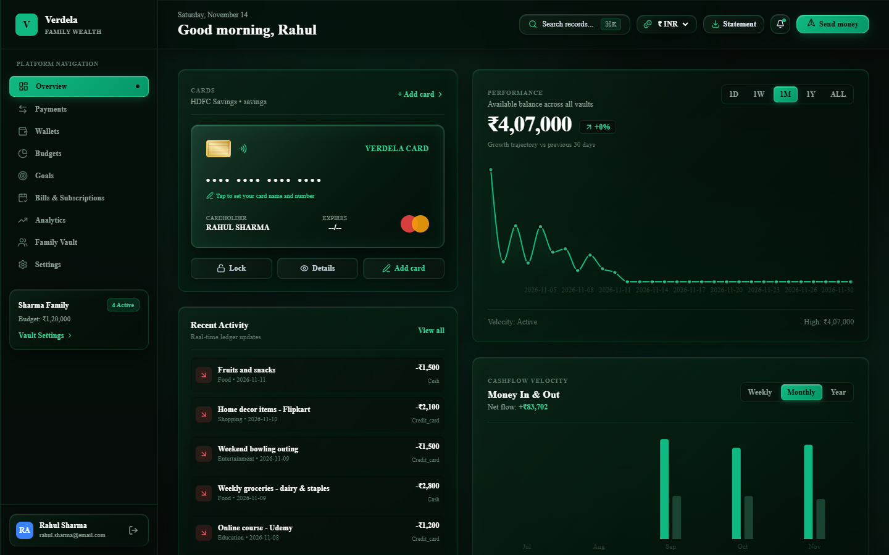
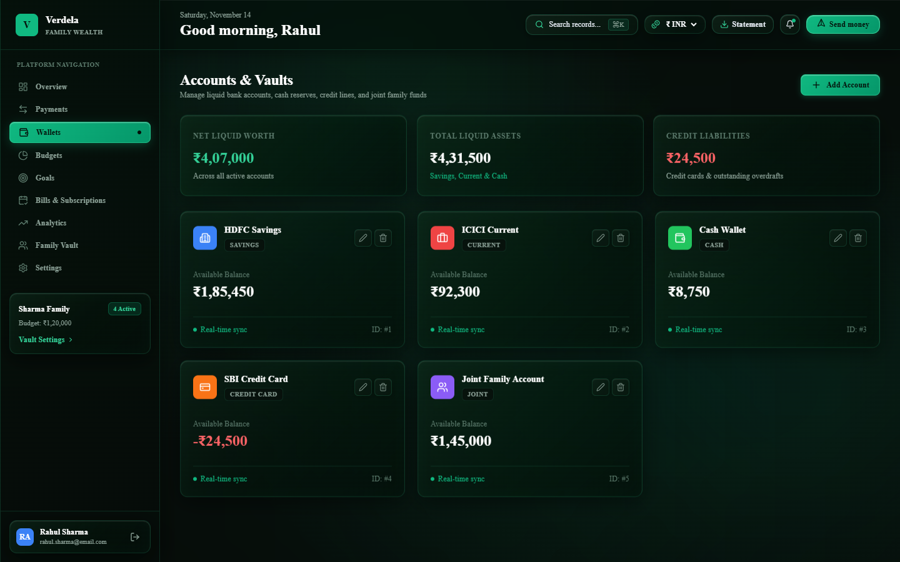
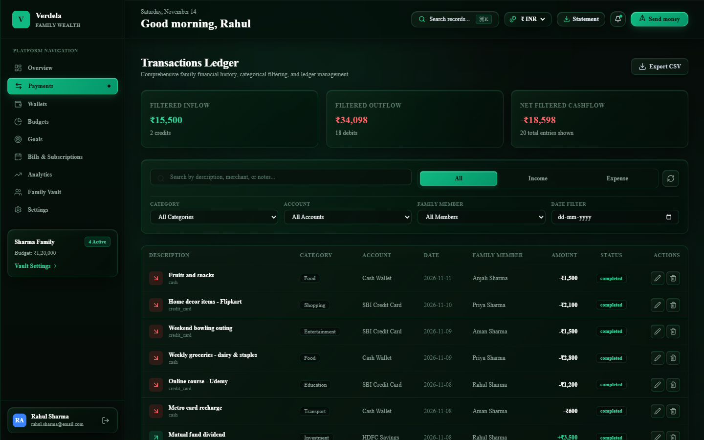
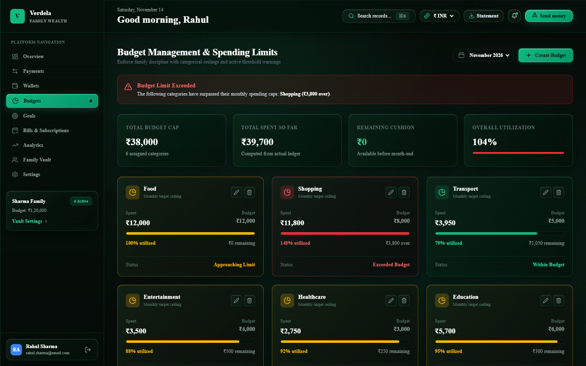
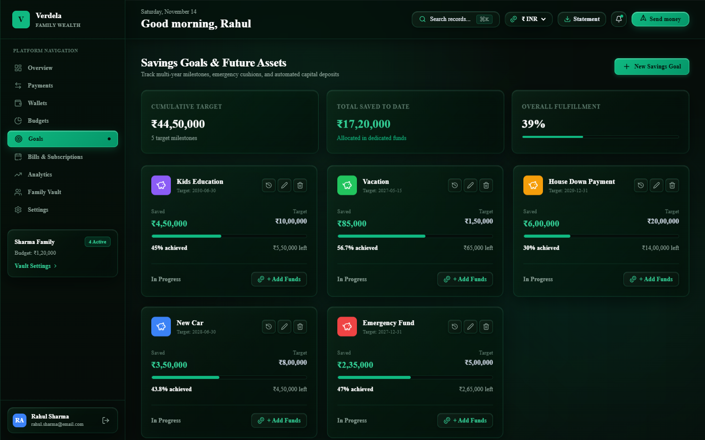
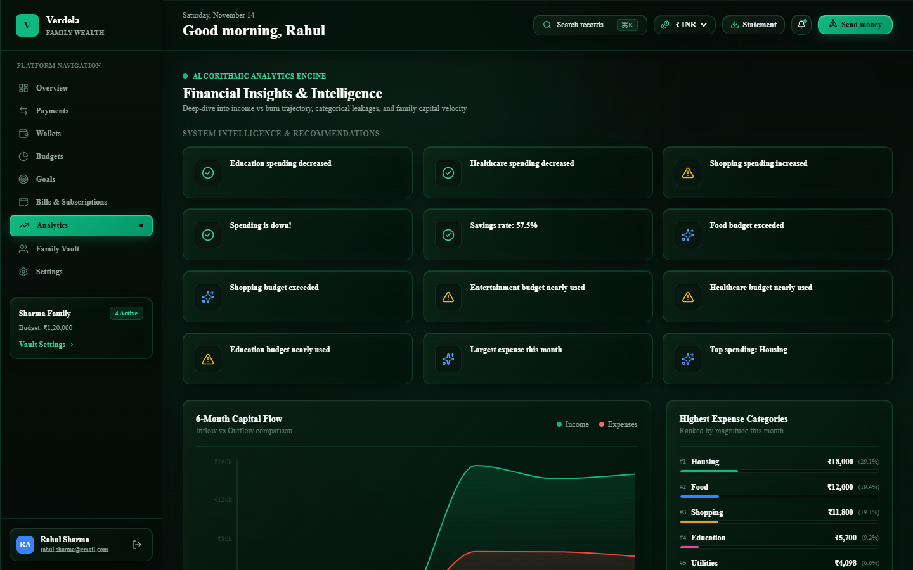

# Money Expense Tracker (Verdela)

[](https://github.com/zuhayr420/Money-Expense-Tracker/actions)
[](https://github.com/zuhayr420/Money-Expense-Tracker/actions)
[](https://github.com/zuhayr420/Money-Expense-Tracker/releases)
[](LICENSE)
[](https://www.typescriptlang.org/)
[](https://www.python.org/)
[](https://react.dev/)

A full-stack personal and family financial management web app. It provides an all-in-one dashboard to track multiple accounts, organize income and expenses, set category budgets with warning thresholds, manage savings goals, and visualize spending trends.

---

## Screenshots

### 1. Dashboard Overview
Summary cards for net worth, cash flow, card carousel, and recent transactions.


### 2. Accounts & Cards
Track savings, checking, and cash balances alongside interactive payment cards with one-click lock/unlock.


### 3. Transactions Ledger & CSV Export
Filter by category, date range, or family member, with quick CSV export support.


### 4. Budgets & Spending Limits
Monthly category allocations with progress bars and automated 80% and 100% threshold indicators.


### 5. Savings Goals
Set milestone targets, log periodic contributions, and track progress toward completion.


### 6. Analytics & Spending Insights
Breakdown charts and trend lines for monthly income, expenses, and category distributions.


---

## Features

- **Multi-Account Tracking**: Real-time balance calculations across savings, checking, credit, and cash accounts.
- **Transaction Management**: Add, edit, categorize, and filter transactions. Export transaction logs directly to CSV.
- **Budgeting Engine**: Set monthly limits per category with visual alerts when reaching 80% or 100% utilization.
- **Savings Goals**: Track target amounts, completion deadlines, and historical contributions.
- **Recurring Bills**: Manage recurring subscriptions and utility bills with due date reminders and status toggles.
- **Family Vault**: Role-based access (admin, member) with individual monthly spending limits.
- **Analytics & Visualizations**: Interactive Recharts graphs showing cash flow trends and category percentages.
- **Multi-Currency Support**: Switch display currencies between INR (₹), USD ($), EUR (€), and GBP (£).

---

## Tech Stack

- **Frontend**: React 19, TypeScript, Tailwind CSS v4, Framer Motion, Recharts, Lucide Icons, Axios, Vite
- **Backend**: Python Flask 3.0, Flask-SQLAlchemy, Flask-CORS, PyJWT, Werkzeug password hashing
- **Database**: SQLite (default local file)
- **CI & Testing**: GitHub Actions, Pytest, CodeQL, Dependabot

---

## Project Structure

```text
├── backend/
│   ├── models/                   # SQLAlchemy models (User, Account, Transaction, Budget, Goal, Bill)
│   ├── routes/                   # Flask blueprints (auth, accounts, transactions, budgets, etc.)
│   ├── tests/                    # Pytest integration & unit test suite
│   ├── utils/                    # JWT authentication helper functions
│   ├── .env.example              # Sample environment configuration
│   ├── app.py                    # Flask application factory & CORS configuration
│   ├── requirements.txt          # Python dependencies
│   └── seed_data.py              # Sample data generator for quick testing
├── docs/
│   └── screenshots/              # Application UI previews
├── frontend/
│   ├── src/
│   │   ├── components/           # Layout, header, sidebar, and modals
│   │   ├── context/              # Auth and Currency React contexts
│   │   ├── pages/                # Overview, Accounts, Transactions, Budgets, Goals, Insights
│   │   ├── services/             # Axios API service layer
│   │   └── types/                # TypeScript interface declarations
│   ├── package.json              # NPM dependencies and scripts
│   └── vite.config.ts            # Vite bundler configuration
├── .github/
│   ├── workflows/                # CI test pipeline & CodeQL security scans
│   ├── ISSUE_TEMPLATE/           # Bug report and feature request templates
│   └── dependabot.yml            # Automated dependency updates
├── .gitignore                    # Exclusions (.env, node_modules, database files)
├── LICENSE                       # MIT License
├── pytest.ini                    # Pytest test configuration
└── README.md                     # Documentation
```

---

## Getting Started

### Prerequisites
- **Python 3.10+**
- **Node.js 18+ & npm**

### 1. Clone the repository
```bash
git clone https://github.com/zuhayr420/Money-Expense-Tracker.git
cd Money-Expense-Tracker
```

### 2. Backend Setup
```bash
cd backend

# Create and activate virtual environment
# Windows:
python -m venv venv
.\venv\Scripts\activate

# macOS / Linux:
# python3 -m venv venv
# source venv/bin/activate

# Install dependencies
pip install -r requirements.txt

# Seed sample data (creates demo accounts, transactions, and budgets)
python seed_data.py

# Start the Flask API
python app.py
```
The API server will run at `http://localhost:5000`.

### 3. Frontend Setup
Open a second terminal window:
```bash
cd frontend

# Install packages
npm install

# Start the dev server
npm run dev
```
Open your browser and navigate to `http://localhost:5173`.

### 4. Default Test Credentials
If you seeded the sample data, you can sign in with:
- **Username**: `demo`
- **Password**: `demo123`

You can also use the **Register** form on the login page to create a new local account.

---

## Running Tests

Run the backend test suite:
```bash
pytest
```

Run frontend type-checking and production build:
```bash
cd frontend
npm run build
```

---

## Security

- Passwords hashed using Werkzeug / salted bcrypt hashing.
- Endpoints protected with JWT bearer tokens.
- Security headers configured (`X-Content-Type-Options: nosniff`, `X-Frame-Options: SAMEORIGIN`, `X-XSS-Protection: 1; mode=block`).
- Sensitive local configuration (`.env`) and local SQLite database files are excluded from Git via `.gitignore`.

---

## License

This project is licensed under the [MIT License](LICENSE).
